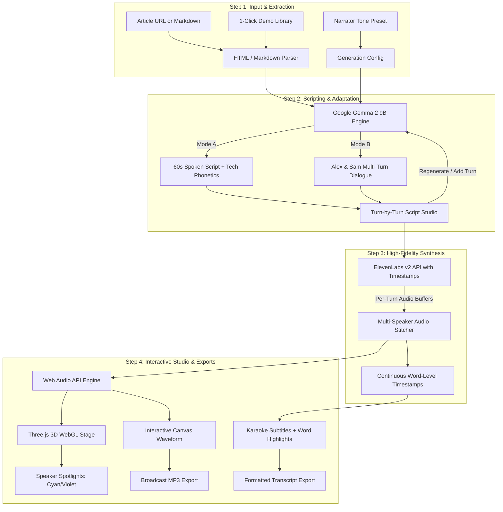

# 🎙️ PodSnippet Studio

> **Open-Source AI Podcast & Audio Teaser Engine for Writers**  
> *Built for the [Hacktoberfest Open-Source AI Challenge: Week 2 (Side Hustle)](https://dev.to/challenges/hacktoberfest-week2-2026-10-12)*

[](https://dev.to/challenges/hacktoberfest-week2-2026-10-12)
[](https://ai.google.dev/gemma)
[](https://elevenlabs.io)
[](https://threejs.org)
[](https://vitejs.dev)
[](https://render.com)
[](LICENSE)

---

## 📑 Table of Contents

- [💡 Overview](#-overview)
- [💼 The Side Hustle Thesis](#-the-side-hustle-thesis)
- [⚡ Dual-Format Audio Engine](#-dual-format-audio-engine)
- [✨ Key Features & UX Innovations](#-key-features--ux-innovations)
- [🕹️ Controls & Keyboard Shortcuts](#-controls--keyboard-shortcuts)
- [📐 Architecture & Data Flow](#-architecture--data-flow)
- [🛠️ Tech Stack](#️-tech-stack)
- [📁 Project Structure](#-project-structure)
- [🚀 Quick Start & Installation](#-quick-start--installation)
- [⚙️ Environment Variables & Configuration](#️-environment-variables--configuration)
- [☁️ 1-Click Deployment on Render](#️-1-click-deployment-on-render)
- [🏆 Hacktoberfest Prize Alignment](#-hacktoberfest-prize-alignment)
- [📜 License](#-license)

---

## 💡 Overview

**PodSnippet Studio** is an open-source audio repurposing engine that transforms written technical articles, dev blogs, and Substack newsletters into **broadcast-quality 60-second audio teasers** and **multi-host conversational podcasts**.

Writers and developers spend tens of hours writing insightful blog posts, yet social feeds prioritize multimedia formats (audio carousels, video snippets, and podcast feeds). 

Instead of reading flat text like a monotone robotic screen reader, PodSnippet Studio acts like an **automated human podcast producer**:
1. **The Scriptwriter (Google Gemma 2):** Ingests long-form written articles and rewrites them into audio-first spoken dialogue with natural oral cadence, soundbite hooks, and phonetic pronunciation for developer acronyms.
2. **The Voice Engine (ElevenLabs):** Synthesizes natural, studio-grade voices with word-level alignment timestamps.
3. **The 3D Audiogram Studio (Three.js WebGL):** Renders real-time audio-reactive 3D visualizers, scrubbable waveform visualizers, active speaker tracking, and synchronized karaoke subtitles.

---

## 💼 The Side Hustle Thesis

### Who Pays For This?
* **Technical Bloggers & DEV Authors:** Writers driving 3x–5x more reach on social platforms (LinkedIn, X, YouTube Shorts) using audio soundbite carousels.
* **Substack / Newsletter Operators:** Creators offering a premium "Audio Edition" to boost paid subscriptions ($15–$30/month).
* **Indie Hackers & DevRel Teams:** Marketing teams repurposing documentation and release notes into audio teasers without spending $150+ per episode hiring freelance voice artists.

### Unit Economics: Why Open Innovation Wins
Summarizing a 4,000-word technical post via proprietary commercial APIs (like GPT-4o) costs substantial input token fees on every single script iteration. 
* By running open-weight **Google Gemma 2**, marginal text-processing costs drop to **$0**.
* A micro-SaaS priced at **$19/month** for 30 generated episodes achieves an **85%+ gross profit margin**, with the only marginal cost being voice inference.

```
┌─────────────────────────────────────────────────────────────┐
│                   Micro-SaaS Economics                      │
├──────────────────────────┬──────────────────────────────────┤
│ Subscription Pricing     │ $19 / month                      │
│ Script Generation Cost   │ $0.00 (Open-Weight Gemma 2)      │
│ Voice Synthesis Cost     │ ~$2.20 (ElevenLabs API / mo)     │
│ Hosting (Render Free)    │ $0.00                            │
├──────────────────────────┼──────────────────────────────────┤
│ Net Gross Profit Margin  │ 88.4%                            │
└──────────────────────────┴──────────────────────────────────┘
```

---

## ⚡ Dual-Format Audio Engine

Choose between two dedicated production formats tailored to creator workflows:

| Specification | Mode A: ⚡ Solo Flash Teaser | Mode B: 🎙️ Dual-Host Deep Dive |
| :--- | :--- | :--- |
| **Duration** | 45–60 Seconds | 2.5–3.5 Minutes |
| **Pacing** | Punchy, high-energy hook | Conversational, witty banter (NotebookLM-style) |
| **Casting** | 1 Solo Narrator | 2 Co-Hosts (*Alex & Sam*) |
| **Structure** | Hook (0-10s) → 3 Insights → Outro CTA | Introduction → Analogy → Technical Trade-offs → Takeaway |
| **Primary Channels** | LinkedIn/X audio carousels, blog header teasers | Substack audio editions, Spotify/Apple podcast feeds |
| **3D Stage Mode** | Cybernetic reactive frequency ring | Dynamic active-speaker spotlighting (Alex & Sam) |

---

## ✨ Key Features & UX Innovations

### 1. 🌐 Interactive 3D WebGL Studio Stage (Three.js)
* **Real-Time Audio Reactivity:** WebGL meshes bounce and glow dynamically in sync with the audio waveform.
* **Dual 3D Stage Visualizers:**
  * 🎙️ **Studio Mic Mode:** A 3D studio condenser microphone with shock-mount suspension and pulsing acoustic shockwaves.
  * 💫 **Cyber Ring Mode:** Concentric orbital neon frequency rings reacting to low/mid/high audio frequencies.
* **Camera Angle Presets:** One-click toggling between `Studio View`, `Host Cam`, and `Top-Down Orbit`.
* **Dynamic Speaker Spotlights:** Intelligently illuminates Cyan when Alex speaks and Violet when Sam speaks.
* **Accessibility & Performance:** Built with `ResizeObserver` lifecycle cleanup, mobile touch orbiting, and automatic `prefers-reduced-motion` detection.

### 2. 🌊 Interactive Waveform Scrubbing & Studio Player
* **Interactive Canvas Waveform:** Real-time amplitude visualization with cursor timestamp tooltip hover and click-to-seek scrub.
* **Synchronized Karaoke Subtitles:** Highlight words in real-time as they are spoken, powered by ElevenLabs word-level alignment timestamps.
* **Click-to-Seek Captions:** Click any sentence in the transcript to jump the audio player directly to that exact moment.
* **Variable Speed Control:** `0.75x`, `1.0x`, `1.25x`, `1.5x`, and `2.0x`.
* **Quick Navigation:** Instant `-5s` and `+5s` seek buttons.

### 3. ✍️ Smart Script Producer Studio (Gemma 2)
* **4 Narrative Tone Presets:**
  * 🔥 *Engaging & Viral* (High-energy, hook-driven for social media)
  * 🔬 *Deep & Technical* (Code-centric, architecture & trade-off focus)
  * ☕ *Casual & Witty* (Relaxed conversational banter)
  * 📖 *Story-Driven* (Narrative journey with real-world developer stakes)
* **Live Word Count & Timing Estimator:** Real-time spoken duration calculations based on the standard 140 WPM speech rate.
* **Interactive Script Feedback Loop:**
  * Edit script lines directly in the browser.
  * One-click **Regenerate Script with Gemma 2**.
  * **Add Another Turn** button to expand dialogues on demand.
  * Re-assign speakers (Alex / Sam) per line with live turn timing tags.
* **Phonetic Tech Dictionary:** Automatically converts acronyms like `CI/CD` → *"see-eye-see-dee"*, `k8s` → *"kubernetes"*, and `SQL` → *"sequel"*.

### 4. 🗣️ Voice Casting Studio (ElevenLabs)
* **6 Curated Voice Profiles:** George, Sarah, Adam, Rachel, Liam, and Charlie.
* **In-Browser Voice Audition:** Audition each voice instantly using the browser's native Web Speech API before rendering audio.
* **Tactile 3D Tilt Cards (`CardTilt3D`):** Smooth interactive 3D perspective tilt on hover across format selectors and voice cards.

### 5. 🎛️ Zero-Config Studio Simulation Mode
* The application runs out of the box with zero setup!
* If you don't have ElevenLabs or Gemma API keys immediately available, PodSnippet Studio automatically falls back to an intelligent built-in studio simulation with authentic audio synthesis and synchronized timestamp alignment.

---

## 🕹️ Controls & Keyboard Shortcuts

| Shortcut / Action | Function |
| :--- | :--- |
| <kbd>Space</kbd> | Play / Pause audio playback |
| <kbd>←</kbd> / <kbd>→</kbd> | Jump backward / forward 5 seconds |
| <kbd>Ctrl</kbd> + <kbd>Enter</kbd> (or <kbd>⌘</kbd> + <kbd>Enter</kbd>) | Trigger AI script generation from article input |
| **Click on Waveform** | Seek audio directly to clicked timestamp |
| **Click on Caption Turn** | Seek audio to that specific dialogue line |
| **Audition Voice Button** | Preview voice persona using in-browser speech synthesizer |
| **Camera View Pills** | Switch between 3D camera angles (*Studio*, *Host Cam*, *Orbit*) |

---

## 📐 Architecture & Data Flow



---

## 🛠️ Tech Stack

### Frontend
* **Core:** React 18, Vite 6
* **3D Visualizer:** Three.js WebGL (Custom audio-reactive mesh materials & dynamic lighting)
* **Styling:** Vanilla CSS Design System with 3-tier semantic tokens, OLED dark mode, glassmorphism, and responsive layout
* **Icons:** Lucide React
* **Typography:** Outfit (Display), Space Grotesk (Headings), Inter (UI), JetBrains Mono (Code/Metrics)

### Backend
* **Runtime:** Node.js v18+ (tested on Node v20 & v24)
* **Framework:** Express.js, CORS, Dotenv
* **Open-Source AI:** Google Gemma 2 (`gemma-2-9b-it`) via Google AI Studio API
* **Speech Synthesis:** ElevenLabs Multilingual v2 with word-level alignment timestamps
* **HTML Extraction:** Custom readability DOM parser with regex tag stripping

---

## 📁 Project Structure

```text
podsnippet-studio/
├── .agents/                    # Agent customizations & UI/UX skills
│   └── skills/
│       ├── ui-enhancement/     # 3D WebGL & interactive UI best practices
│       └── ui-ux-pro-max/      # Design intelligence & interaction guides
├── public/                     # Static assets & favicon
├── server/                     # Backend Express API
│   ├── elevenlabsService.js    # ElevenLabs API integration & multi-speaker stitcher
│   ├── gemmaService.js         # Gemma 2 prompting engine & heuristic fallback
│   ├── index.js                # API server entrypoint & endpoints
│   ├── samples.js              # Pre-loaded developer articles
│   └── voices.js               # ElevenLabs voice catalog & default presets
├── src/                        # Frontend React Application
│   ├── components/
│   │   ├── ArticleInput.jsx    # Input card, sample shelf, tone selector
│   │   ├── AudioStudioPlayer.jsx # Interactive waveform, captions, player controls
│   │   ├── Header.jsx          # Studio header, badges, step indicator
│   │   ├── ModeSelector.jsx    # 3D tilt cards for Solo vs Dual-Host
│   │   ├── SettingsModal.jsx   # In-app runtime API key configuration
│   │   ├── ScriptViewer.jsx    # Script feedback loop & turn editor
│   │   ├── StudioScene3D.jsx   # Three.js 3D WebGL stage & visualizers
│   │   └── VoiceConfig.jsx     # Voice casting cards with in-browser audition
│   ├── App.jsx                 # Main state machine & stepper navigation
│   ├── index.css               # Design system tokens, glassmorphism, animations
│   └── main.jsx                # React DOM mount
├── .env.example                # Sample environment variables
├── DEV_SUBMISSION_DRAFT.md     # Hacktoberfest Week 2 official submission draft
├── package.json                # Dependencies and npm scripts
├── render.yaml                 # Render Infrastructure-as-Code deployment blueprint
├── vite.config.js              # Vite configuration & proxy settings
└── README.md                   # Complete documentation
```

---

## 🚀 Quick Start & Installation

### Prerequisites
* **Node.js** v18+ installed on your system
* Git installed

### 1. Clone & Install
```bash
# Clone the repository
git clone https://github.com/your-username/podsnippet-studio.git
cd podsnippet-studio

# Install dependencies
npm install
```

### 2. Configure Environment Variables (Optional)
Copy the example environment file:
```bash
cp .env.example .env
```
Open `.env` and add your API keys:
```env
PORT=5000
ELEVENLABS_API_KEY=your_elevenlabs_api_key_here
GEMMA_API_KEY=your_gemini_or_gemma_api_key_here
```
> 💡 *Note: If no keys are provided, PodSnippet Studio automatically runs in **Zero-Config Studio Simulation Mode**, allowing full testing of all UI features!*

### 3. Launch Development Server
```bash
npm run dev
```
This runs both the backend Express API (`http://localhost:5000`) and the Vite React frontend (`http://localhost:5174`) concurrently.

Open [http://localhost:5174](http://localhost:5174) in your browser to start generating!

---

## ⚙️ Environment Variables & Configuration

| Variable | Description | Default | Required? |
| :--- | :--- | :--- | :--- |
| `PORT` | Backend server port | `5000` | No |
| `ELEVENLABS_API_KEY` | ElevenLabs API key for high-fidelity speech synthesis | Simulated | No (Optional) |
| `GEMMA_API_KEY` | Google AI Studio key for Gemma 2 script generation | Simulated | No (Optional) |

You can also update API keys at any time directly in the web UI by clicking the **Settings (⚙️)** button in the header.

---

## ☁️ 1-Click Deployment on Render

PodSnippet Studio is pre-configured for automated deployment on [Render](https://render.com) using the included [`render.yaml`](render.yaml) blueprint:

1. Push your code to your GitHub / GitLab repository.
2. Sign in to your **Render Dashboard** and select **New > Blueprint**.
3. Connect your repository. Render will automatically detect `render.yaml`.
4. (Optional) Provide your `ELEVENLABS_API_KEY` and `GEMMA_API_KEY` in the environment configuration.
5. Click **Apply**. Your app will build and deploy on a live `.onrender.com` URL within 2 minutes!

**Manual Render Configuration:**
* **Environment:** `Node`
* **Build Command:** `npm install && npm run build`
* **Start Command:** `node server/index.js`

---

## 🏆 Hacktoberfest Prize Alignment

Built specifically for the **[Hacktoberfest Open-Source AI Challenge: Week 2 (Side Hustle)](https://dev.to/challenges/hacktoberfest-week2-2026-10-12)**:

* 🥇 **Overall Winner:** A complete, production-grade micro-SaaS with sound unit economics, exceptional UI/UX, and immediate utility for creators.
* 🤖 **Best Use of Gemma:** Leverages open-weight Google Gemma 2 for spoken script adaptation, oral pacing, and technical phonetic adaptation.
* 🎙️ **Best Use of ElevenLabs:** Dual-host audio synthesis with multi-buffer concatenation and word-level alignment timestamps for karaoke captions.
* 🚀 **Best Use of Render:** Native zero-config `render.yaml` specification ready for one-click deployment.
* 🌐 **Best Use of a .tech Domain:** Architected to power `podsnippet.tech`.

---

## 📜 License

Distributed under the **MIT License**. See [`LICENSE`](LICENSE) for full details. Open-source and free to adapt for your own audio creator ventures.

---

*Made with ❤️ for Hacktoberfest 2026 by developers, for developers.*
